# Лабораторные работы по Python

Репозиторий с лабораторными работами. Исходный код находится в [src/](src/), скриншоты выполнения программ — в [images/](images/).

---

## [Лабораторная работа №1](src/lab01/)  `ВЫПОЛНЕНА`

### 1. Приветствие — [01_greeting.py](src/lab01/01_greeting.py)

Программа запрашивает имя и возраст пользователя, после чего выводит приветствие и сообщает, сколько лет ему исполнится через год.

**Как работает код:** имя читается через `input()` как строка, возраст приводится к целому числу с помощью `int()`. Результат выводится f-строкой, в которой прямо в выражении вычисляется `age+1`.

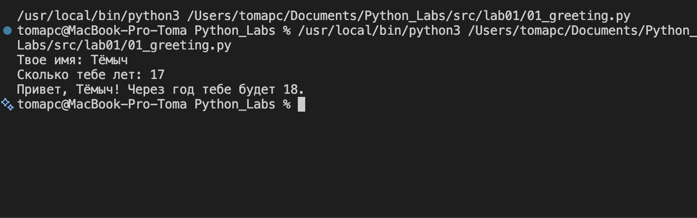

---

### 2. Сумма и среднее — [02_sum_avg.py](src/lab01/02_sum_avg.py)

Программа считывает два вещественных числа и выводит их сумму и среднее арифметическое.

**Как работает код:** оба числа читаются через `input()` и преобразуются в `float`, чтобы работать с дробными значениями. В f-строке вычисляются сумма `a+b` и среднее `(a+b)/2`.

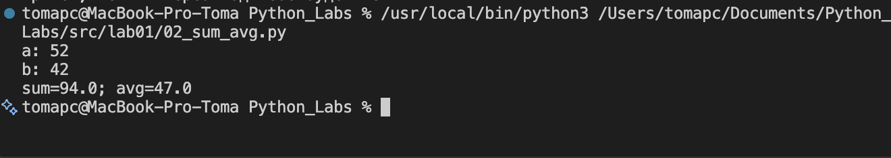

---

### 3. Скидка и НДС — [03_discount_vat.py](src/lab01/03_discount_vat.py)

Программа рассчитывает итоговую стоимость товара: сначала применяется скидка, затем на полученную базу начисляется НДС.

**Как работает код:** на вход подаются цена, процент скидки и процент НДС. База считается как `price*(1-discount/100)`, сумма НДС — как `base*vat/100`, итог — их сумма. Все три значения выводятся с округлением до двух знаков через спецификатор формата `:.2f`.

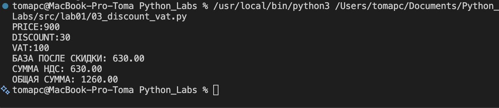

---

### 4. Минуты в часы:минуты — [04_minutes_to_hhmm.py](src/lab01/04_minutes_to_hhmm.py)

Программа переводит количество минут в формат `ЧЧ:ММ`.

**Как работает код:** целочисленное деление `min//60` даёт часы, остаток от деления `min%60` — минуты. Спецификатор `:02d` применяется к обеим частям и дополняет их ведущим нулём, поэтому и часы, и минуты всегда выводятся двузначными.

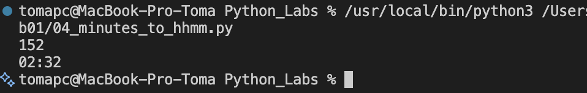

---

### 5. Инициалы и длина ФИО — [05_initials_and_len.py](src/lab01/05_initials_and_len.py)

Программа принимает ФИО и выводит инициалы, а также суммарное количество букв.

**Как работает код:** строка разбивается по пробелам методом `split()` на три части, которые распаковываются в переменные `n1, n2, n3`. Из каждой берётся первый символ и переводится в верхний регистр через `upper()`. Длина считается как сумма `len()` трёх частей — пробелы при этом не учитываются.

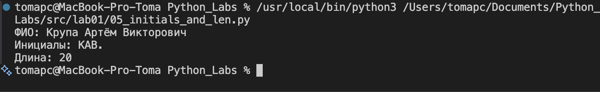

---

### 6. Список регистраций — [06_registration_list.py](src/lab01/06_registration_list.py)

Программа считывает `n` корректных записей о регистрации и подсчитывает, сколько из них со статусом `True`, а сколько — с `False`.

**Как работает код:** цикл `while` работает, пока не набрано `n` валидных записей. Каждая строка проверяется на соответствие формату: первые два поля должны быть буквенными (`isalpha()`), третье — числом (`isdigit()`). Счётчик `i` увеличивается только при успешной проверке, поэтому некорректная запись не засчитывается и запрашивается заново. Приглашение ко вводу нумеруется (`in_1:`, `in_2:`, ...), а в конце выводятся счётчики `t` и `f` с префиксом `out:`.


---

### 7. Расшифровка сообщения — [07_decryption.py](src/lab01/07_decryption.py)

Программа извлекает скрытое сообщение из зашумлённой строки.

**Как работает код:** сначала два цикла находят позицию первой заглавной буквы (`n1`) и позицию первой цифры (`n2`). Разница `m = n2 - n1` задаёт шаг выборки символов. Далее строка обходится начиная с `n1`, и каждый символ, индекс которого кратен `m+1`, добавляется к результату. Обход прерывается при встрече точки — она отмечает конец сообщения.

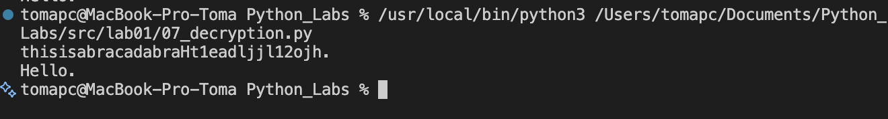

---

## [Лабораторная работа №2](src/lab02/) `ВЫПОЛНЕНА`

### 1 - arrays.py

- `min_max` — проходит по списку циклом и сравнивает каждое число, параллельно заменяя актуальное максимальное и минимальное число. Возвращает котедж `(минимум, максимум)`. Если дан пустой список — `ValueError`.
- `unique_sorted` — превращает список в `set`, чтобы убрать повторы, и сортирует через `sorted()`.
- `flatten` — проходит циклом по значениям всех списков и котеджей в общем списке и складывает все их элементы в один список. Если строка не список и не кортеж — `TypeError`.

**Тесты:**

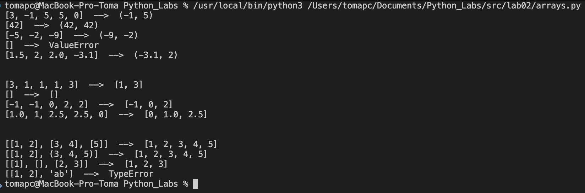

---

### B - matrix.py

- `transpose(mat)` — для каждого столбца собирает его элементы в новую строку, так строки и столбцы меняются местами.
- `row_sums(mat)` — складывает числа в каждой строке.
- `col_sums(mat)` — складывает числа в каждом столбце.

Все три функции сначала проверяют, что строки одной длины, то есть прямоугольность матрицы. Если нет — `ValueError`.

**Тесты:**

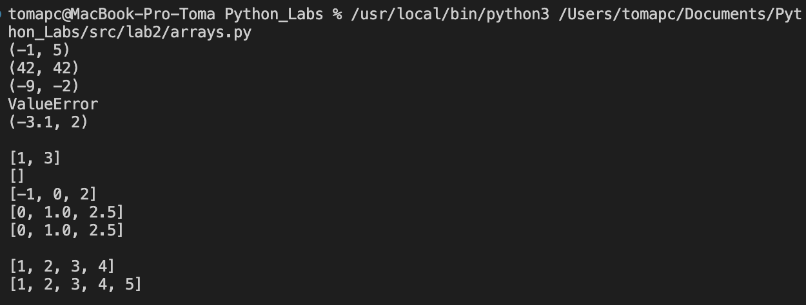

---

### C - tuples.py

- `format_record(rec)` — принимает запись студента формата `(ФИО, группа, GPA)`, убирает лишние пробелы в начале и в конце строки используя `strip()`, записывает инициалы и возвращает строку вида `Иванов И.И., гр. BIVT-25, GPA 4.60`. Неверный тип данных — `TypeError`, пустые или неверные значения — `ValueError`.

**Тесты:**

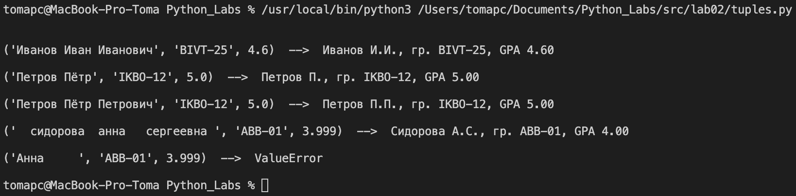

---

## [Лабораторная работа №3](src/lab03/) `ВЫПОЛНЕНА`

### A - text.py — [src/lib/text.py](src/lib/text.py)

- `normalize` — приводит текст к нижнему регистру через `casefold()` (или `lower()`, если `casefold=False`), заменяет `ё` на `е`, меняет `\t`, `\r` и `\n` на пробелы и убирает лишние пробелы через `split()` и `" ".join()`. Если передана не строка — `TypeError`.
- `tokenize` — находит слова регулярным составленным выражением `\w+(?:-\w+)*`: буквы, цифры и **дефис внутри слова**, например,`по-настоящему`. Эмодзи и знаки препинания пропускаются выражением.
- `count_freq` — проходит по списку слов и считает, сколько раз встречается каждое. Возвращает словарь `слово: количество`.
- `top_n` — сортирует пары `(слово, количество)` по ключу `(количество, слово)`, то есть сначала по убыванию частоты, а при равенстве по алфавиту берёт первые `n`.

**Тесты через `assert`:**

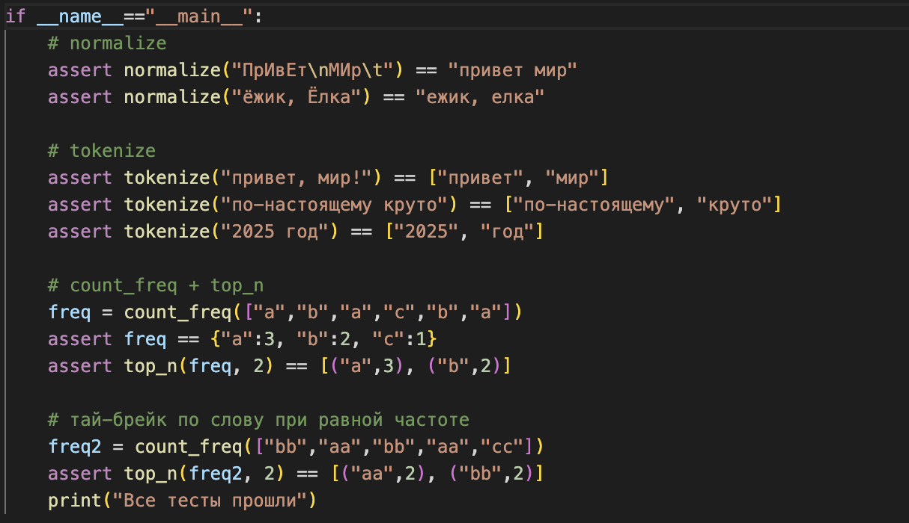

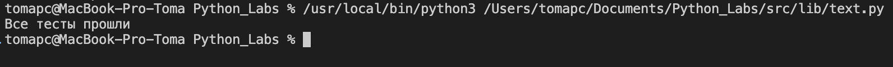

---

### B - text_stats.py — [src/lab03/text_stats.py](src/lab03/text_stats.py)

Программа читает одну строку из stdin и выводит количество слов, количество уникальных слов и топ-5 самых частых, используя **испортированные функции**: `normalize`, `count_freq`, и `top_n`.

**Запуск** (из корня проекта):

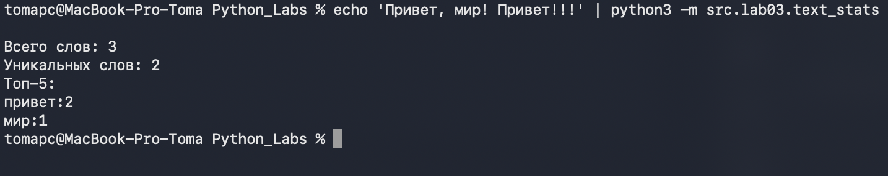

---

### ★ - text_table.py — [src/lab03/text_table.py](src/lab03/text_table.py)

Программа делает то же самое, что и `text_stats.py`, но просто выводит топ-5 в виде выровненной таблицы.

**Запуск:**

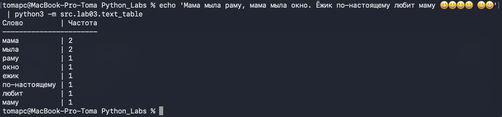

---

## [Лабораторная работа №4](src/lab04/) `ВЫПОЛНЕНА`

### A - io_txt_csv.py — [src/lab04/io_txt_csv.py](src/lab04/io_txt_csv.py)

- `read_text` — читает файл целиком в одну строку. Сначала пробует `utf-8`. Если файл в `utf-8`, параметр `encoding` не применяется. Только если `utf-8` не подошёл, файл читается в указанной кодировке: `read_text("file.txt", encoding="cp1251")`. Если файла нет — `FileNotFoundError`, если не подошла ни одна кодировка — `UnicodeDecodeError`.
- `write_csv` — создаёт или перезаписывает CSV (разделитель `,`, кодировка UTF-8). Если передан `header`, он пишется первой строкой. Если строки разной длины — `ValueError`.
- `ensure_parent_dir` — создаёт родительские папки, если их нет.

**Пустые данные:** `write_csv` с пустым `rows` и без `header` создаёт пустой файл, а с `header` — файл только с заголовком.

**Тест (запись и чтение):**

```bash
python3 -c "from src.lab04.io_txt_csv import read_text, write_csv; write_csv([('test', 3)], 'data/check.csv', header=('word', 'count')); print(read_text('data/check.csv'))"
```

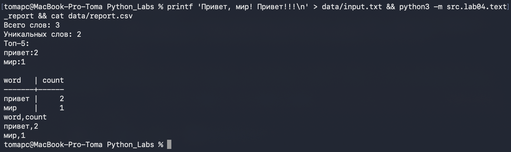

---

### B - text_report.py — [src/lab04/text_report.py](src/lab04/text_report.py)

Скрипт читает текстовый файл, считает частоты слов (функции из ЛР3), сохраняет отчёт в CSV и печатает в консоль краткое резюме и таблицу.

**Запуск** (через `-m`, чтобы Python нашёл пакет `src`):

```bash
printf 'Привет, мир! Привет!!!\n' > data/input.txt && python3 -m src.lab04.text_report && cat data/report.csv
```

**Параметры:** `--in` (входной файл, по умолчанию `data/input.txt`), `--out` (по умолчанию `data/report.csv`), `--encoding` (по умолчанию `utf-8`).

**Решения:**
- **Нет файла** или **неверная кодировка:** выводится понятное сообщение и код выхода 1.
- **Пустой файл:** `report.csv` содержит только заголовок `word,count`.
- **Кодировка cp1251:** передаётся через `--encoding cp1251`, расшифровка применяется только если файл не читается как `utf-8`.
- **Большие файлы:** файл читается целиком; в реальных задачах лучше читать построчно.

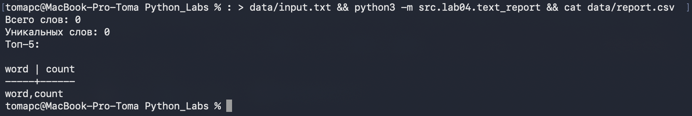

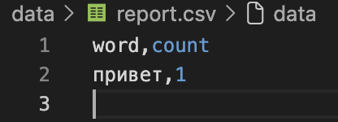

**Пустой файл:**

```bash
: > data/input.txt && python3 -m src.lab04.text_report && cat data/report.csv
```


---

### Тест C — параметр `--encoding`

`read_text` сначала пробует прочитать файл как `utf-8`. Если получилось, параметр `--encoding` не используется. Если `utf-8` не подошёл, файл читается в кодировке из `--encoding`. Если не подошла и она, скрипт выводит сообщение с подсказкой `Попробуйте --encoding cp1251` и завершается с кодом 1.

Так расшифровка делается только тогда, когда она нужна, и обычный `utf-8` файл не превращается в кракозябры, даже если указать `--encoding cp1251`.

**C1. Файл действительно в cp1251** (расшифровка нужна и выполняется):

```bash
printf 'Привет' | iconv -f UTF-8 -t CP1251 > data/input.txt && python3 -m src.lab04.text_report --encoding cp1251 && cat data/report.csv
```

Вывод (кратко):

```
Всего слов: 1
Уникальных слов: 1
Топ-5:
привет:1
```

`report.csv`:

```
word,count
привет,1
```

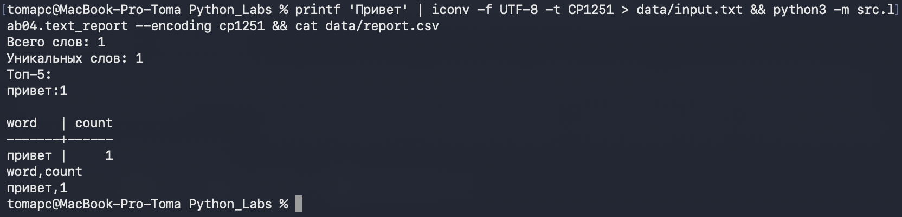

**C2. Файл в utf-8, но указан `--encoding cp1251`** (расшифровка не нужна и не применяется, результат тот же, без кракозябр):

```bash
printf 'Привет' > data/input.txt && python3 -m src.lab04.text_report --encoding cp1251 && cat data/report.csv
```


---

### D* - несколько файлов — [src/lab04/text_report.py](src/lab04/text_report.py)

Если передать несколько файлов, скрипт создаёт два отчёта: `report_per_file.csv` (колонки `file,word,count`) и `report_total.csv` (`word,count`). Таблица в консоль печатается всегда, ширина столбцов по самому длинному значению.

```bash
printf 'Привет мир' > data/a.txt && printf 'Привет, привет!' > data/b.txt && python3 -m src.lab04.text_report --in data/a.txt data/b.txt && cat data/report_per_file.csv data/report_total.csv
```

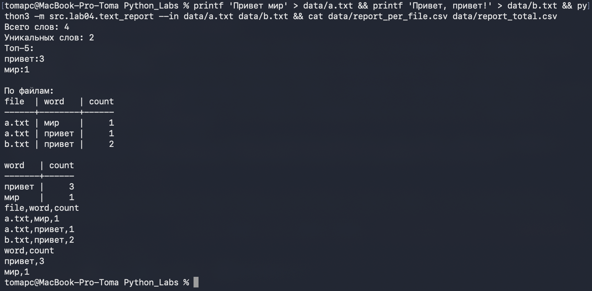

---

## Сброс файла ``input.txt`` для повторного запуска тестов:

```bash
: > data/input.txt
```

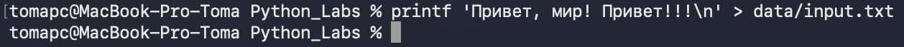

---

## [Лабораторная работа №5](src/lab05/) `ВЫПОЛНЕНА`

### Что сделано
- `src/lab05/json_csv.py` — функции `json_to_csv` и `csv_to_json`
- `src/lab05/csv_xlsx.py` — функция `csv_to_xlsx` (библиотека openpyxl)
- примеры в `data/samples/`, результаты в `data/out/`

### Установка нужных библиотек
```
pip3 install -r requirements.txt
```

### Допущения
- JSON должен быть списком словарей.
- Порядок колонок в CSV: как в первом объекте, новые ключи из остальных идут в конец.
- Пропущенные поля заполняются пустой строкой.
- Все значения из CSV в JSON остаются строками.
- Кодировка везде UTF-8.
- Ошибки: неверное расширение или пустой файл — `ValueError`, нет файла — `FileNotFoundError`.

### Задание A: JSON → CSV
```
python3 -c "from src.lab05.json_csv import json_to_csv; json_to_csv('data/samples/people.json', 'data/out/people_from_json.csv')"
```


### Задание A: CSV → JSON
```
python3 -c "from src.lab05.json_csv import csv_to_json; csv_to_json('data/samples/people.csv', 'data/out/people_from_csv.json')"
```


### Задание B: CSV → XLSX
```
python3 -c "from src.lab05.csv_xlsx import csv_to_xlsx; csv_to_xlsx('data/samples/people.csv', 'data/out/people.xlsx')"
```


### Проверка ошибок

